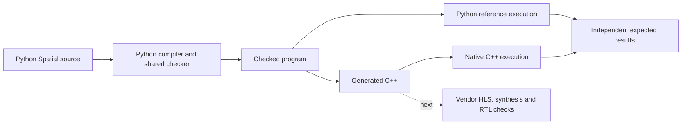

# Python Spatial now generates executable C++

**The first C++ backend is working for a bounded family of memory programs.**
The Python compiler checks the source, then generates ordinary C++ arrays,
loops, branches and arithmetic. That generated code compiles and runs locally.
The existing Python reference engine remains a separate way to check meaning.

David asked us to start this path on 21 October, prioritizing functional C++
correctness before hardware simulation. This follows the audit in
[[2026-10-21-hls-feasibility-checkpoint]]. It keeps the Python core and brings
target feedback forward; all language families do not have to be finished first.

## What has run

| Program or behavior | Result checked |
|---|---|
| Existing Lab 1 tiled-memory scale program | Two 16-element tiles; input 0–31 with scale 2 produces 0,2,…,62 |
| Same program at Int32 limits | Independent overflowing fixture produces the specified wrapped values |
| Five-element program with two-element tiles | The final partial tile and a helper capturing local SRAM produce `[3,4,5,6,7]` from `[1,2,3,4,5]` |
| Overlapping local copy | Copying the first three cells into positions 1–3 of `[1,2,3,4]` produces `[1,1,2,3]`, preserving snapshot semantics |
| Branches, nested/reversed views and local storage | Bounds, initialization and fresh lifetimes retain the specified behavior |
| Faults after earlier writes | Earlier writes remain; the faulting copy commits no partial transfer; incomplete outputs are not published |

The demo checks C++ and Python reference outputs **separately against independent
expected values**. This is not automatic Scala-to-Python translation or a
Scala/Python runtime comparison. The Lab 1 source is our existing authored Python
version. Other renamed, resized and composed programs use the same lowering rules.

Production is frozen at **`spatial-py@348d15a`**. Review fixed an inclusive-bound
error in a numeric guard, added a separate source-provenance revision, and repaired
the installed-test reproduction instructions. Full acceptance details belong in
the linked compiler evidence; native checks do not establish FPGA timing.

## Scope and the next step

The first profile supports rank-one Int32 memory, fixed SRAM capacities, bounded
views, loops, branches, scalar inputs and scalar/Unit helpers. It uses shared
operation rules and checked helper bindings. It does not recognize lab names or
complete application patterns. Local aliases share storage; copies use explicit
finite snapshots. The first host ABI requires distinct contiguous port buffers.

This is a sequential baseline. Requested parallelism is recorded, but achieved
pipelining, memory banking and hardware cost remain to be measured. The Lab 1
artifact reports 96 storage cells including its 64 port cells, plus 32 snapshot
cells; the five-element example reports 12 and 4. These are conservative emitted
cell counts, not FPGA resource estimates. Masks and scalar state cost extra.

Rank-two target memory, runtime Index ports, scalar output cells, borrowed helper
returns and unsupported guard forms remain explicit target limitations. Some
already work in the reference engine. The C++ emitter rejects what it cannot
preserve rather than silently narrowing the language.

Next: prepare a scoped vendor project and self-checking testbench, pin its
release/device/clock and interfaces, then run vendor C simulation, synthesis and
C/RTL co-simulation. Review snapshot, initialization and arithmetic costs when
introducing banking or pipelining. We will tell David when that package needs
the HLS instance; this local checkpoint did not start it.

This artifact is not yet a checked target implementation plan. Full REP-S6/S7,
vendor validation and the original [[80 - Initial Compiler Goal|reference acceptance obligations]]
remain open. Public check/prepare, cumulative resumption and wider
Labs 1–3 language support remain planned work.

## Records and reproduction

- [Compiler evidence and scope](https://github.com/davidydu/spatial-py/blob/work/initial-reference/docs/evidence/task-06a-native-cpp.md)
- [Reviewed implementation plan](https://github.com/davidydu/spatial-py/blob/06b8e35/docs/plans/2026-10-21-cpp-feasibility.md)
- [Frozen backend implementation](https://github.com/davidydu/spatial-py/tree/348d15a/src/spatial/backends)
- [Runnable demo](https://github.com/davidydu/spatial-py/blob/348d15a/examples/run_cpp_reference.py)
- [Generated kernels, native reporting testbenches and results](https://github.com/davidydu/spatial-py/tree/work/initial-reference/docs/evidence/native-cpp-demo)
- [Review and fixes](https://github.com/davidydu/spatial-py/blob/work/initial-reference/docs/reviews/2026-10-21-native-cpp.md)

From the implementation checkout, run `examples/run_cpp_reference.py` with the
package on Python's import path and a working C++17 compiler. The compiler
evidence gives the exact environment, including the local Mac SDK workaround.
Generated native tests run optimized with undefined-behavior sanitization.
