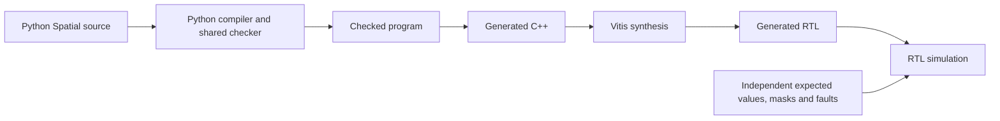

# Python Spatial programs now pass RTL simulation

**We can now take a supported Python Spatial program, generate C++, synthesize
it into hardware, and check that hardware's results.** Four programs and nine
cases passed native C++, Vitis C simulation and Verilog RTL co-simulation.
Synthesis produced the hardware and resource reports for all four.

The existing Python compiler foundation worked for this step. We added a small
hardware interface and a self-checking testbench. **The semantic core and C++
emitter needed no change.** This follows [[2026-10-21-generated-cpp-checkpoint]]
and David's authorization to use the HLS instance.

## What the hardware tests cover

| Program | What it tests | Cases |
|---|---|---:|
| Lab 1 tiled scale | DRAM/SRAM transfers, two tiles, scalar multiplier, Int32 overflow | 2 |
| Partial tile | Five inputs in two-element tiles, a one-element tail, captured helper | 1 |
| Window passes | Nested/reversed views, overlapping copies, helpers, overflow, and a late bounds fault with ten previous writes preserved | 3 |
| Independently written pair ordering | Input/output memory, local snapshot, a Bool helper, branches, extreme arithmetic, and incomplete-output detection | 3 |

Seven cases complete normally. Two deliberately fault; passing means the hardware
reports the right fault and leaves exactly the expected memory state. Every
testbench checks initialization flags and all initialized cell values, including
inputs. It does not treat meaningless uninitialized bits as values.

The pair-ordering program was written after compiler version **`da4d35f`** was
frozen. It passed its first native run and then the vendor runs without compiler
or oracle repairs. The compiler uses operation rules shared across these programs;
there is no Lab 1 or whole-program recognizer.

## What this tells us about the architecture

The checked representation retained enough information to generate real hardware:
finite memory, control flow, helper bindings, view bounds and fault ownership.
The same meaning survived native execution, vendor compilation and RTL simulation
for these cases. This is useful evidence that the Python base supports the HLS
direction. It is not proof that every language feature or hardware schedule works.

This first version is sequential. Its interface exposes fixed-depth memories,
initialization flags and fault status. It is a small hardware IP experiment; it
does not yet connect an accelerator to a board's external DRAM through AXI.

| Program | HLS LUT / FF / DSP estimate | Observed RTL latency |
|---|---|---|
| Lab 1 | 1,269 / 622 / 3 | 863 cycles |
| Partial tile | 1,353 / 815 / 0 | 122 cycles |
| Window passes | 1,566 / 594 / 0 | 298–327 cycles |
| Pair ordering | 1,100 / 255 / 0 | 102–106 cycles |

Settings: **Vitis 2025.1, Z020, 10 ns clock, 2.7 ns uncertainty**. Resource
estimates exclude external memories attached to the IP ports. Latency varies
with the tested path. These are simulation observations and HLS estimates, not
board measurements, routed timing closure or optimized throughput. The full
record distinguishes transaction intervals from loop initiation intervals.

## A limitation found by independent testing

The first fresh candidate combined memory updates with an integer shift. The
checker accepted it, but the C++ backend rejected the normalized Index-valued
shift count. That candidate is preserved as a negative test, with its original
expected results. We did not delete its shift to claim success. A separate author
then wrote the different pair-ordering program within the admitted target scope.

This gives us a concrete next task: implement general shift-count lowering and
check its edge cases through the same path. Rank-two target memories, scalar
output cells, loop carries and borrowed helper results also remain target gaps;
the reference engine supports more than the current HLS profile.

Then use these measurements to choose memory banking and pipelining work, while
preserving snapshots, initialization and fault behavior. Continue the public
workflow and Labs 1–3 language increments in [[04 - Python Implementation Roadmap]].
Full checked target planning, the [[80 - Initial Compiler Goal|original reference acceptance]],
board integration and wider language coverage remain open.

## Inspect and reproduce

- [Compiler evidence and reproduction commands](https://github.com/davidydu/spatial-py/blob/work/initial-reference/docs/evidence/task-06b-vitis.md)
- [Results, settings, resource estimates and source hashes](https://github.com/davidydu/spatial-py/blob/work/initial-reference/docs/evidence/vitis-demo/results.json)
- [Generated projects, reports and Verilog](https://github.com/davidydu/spatial-py/tree/work/initial-reference/docs/evidence/vitis-demo)
- [Fresh program and independent expectations](https://github.com/davidydu/spatial-py/blob/work/initial-reference/docs/evidence/task-06b-vitis-acceptance-second.md)
- [Rejected first candidate and retained target limitation](https://github.com/davidydu/spatial-py/blob/work/initial-reference/docs/evidence/task-06b-vitis-acceptance.md)
- [Specification, code review and vendor warnings](https://github.com/davidydu/spatial-py/blob/work/initial-reference/docs/reviews/2026-10-21-vitis.md)

The lab source is an authored Python version of the course pattern. This is not
automatic Scala-to-Python translation or a Scala/Python equivalence test.
